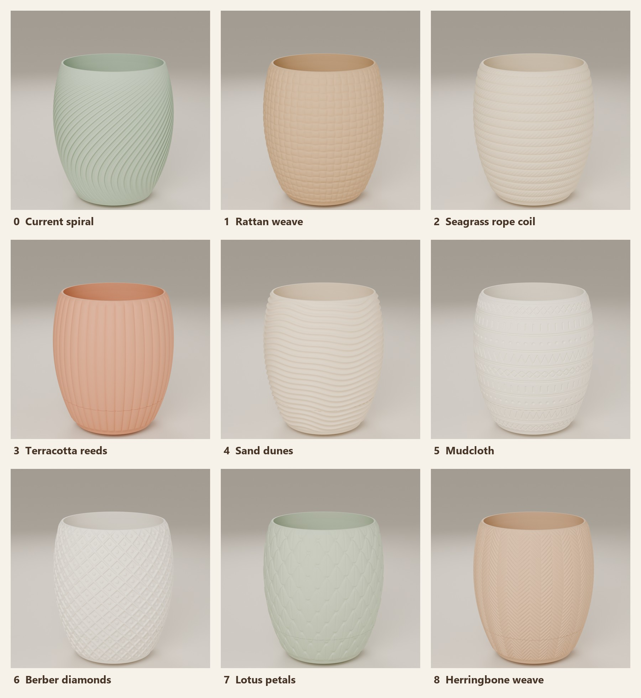
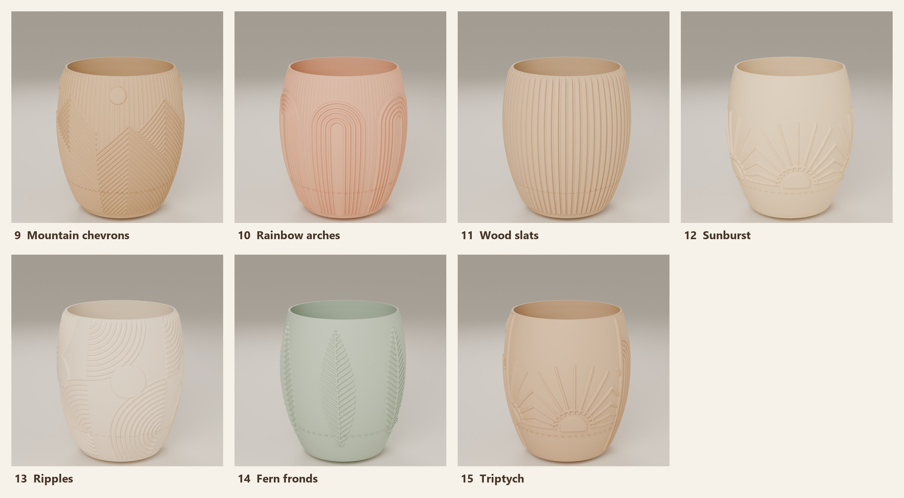

# Pot designs × sizes

> Derived from **[Brynhild – Hanging planter (LODRET compatible)](https://makerworld.com/en/models/1343487)** by **[Epiq3D](https://makerworld.com/en/@EPIQ3D)**. Every design keeps Epiq3D's pot interior, rim, drip-tray fit, wick feet and LODRET rail; only the outside surface and the size are new. Credit for the original goes to Epiq3D.

Each design folder holds its render. **The print files aren't published**, because they're derivatives of Epiq3D's licensed model. Generate any design at any size from your own download with `build_sizes.py`; it writes one 3MF per size with the pot (100% LODRET rail), matching drip tray and 3 wick feet. See [Generate the print files](../README.md#generate-the-print-files).

Every set I built was checked: pot and tray watertight; rail joint identical to the original (rail head 46.19 mm, hanger shoulder 4.00 mm, wing clearance 7.85 mm below the rail top).

## Designs

| Render | Folder | Design | Notes |
|---|---|---|---|
|  | `0-original` | Current spiral | Epiq3D's original surface |
|  | `1-rattan` | Rattan weave | Over-under basket weave |
|  | `2-rope` | Seagrass rope coil | Stacked twisted rope rings |
|  | `3-reeded` | Terracotta reeds | 40 rounded vertical reeds |
|  | `4-dunes` | Sand dunes | Wandering horizontal ripples |
|  | `5-mudcloth` | Mudcloth | Engraved bands: zig-zag, dots, dashes, crosses. Rub dark wax into the grooves for contrast. |
|  | `6-berber` | Berber diamonds | Raised diamond lattice with dots |
|  | `7-petals` | Lotus petals | Overlapping petals pointing up |
|  | `8-herringbone` | Herringbone weave | Alternating slanted columns |

**Wall-art designs** (based on slatted boho wood wall art), built at 105%, 125% and 155%:

| Render | Folder | Design | Notes |
|---|---|---|---|
|  | `9-mountains` | Mountain chevrons | Nested chevron peaks over fine vertical slats, with a sun disc |
|  | `10-arches` | Rainbow arches | Nested U-arches, six around the pot |
|  | `11-slats` | Wood slats | Flat-faced vertical slats with chamfered edges |
|  | `12-sunburst` | Sunburst | Half-suns rising from the base, with rays |
|  | `13-ripples` | Ripples | Concentric arcs from alternate corners, with a disc |
|  | `14-fern` | Fern fronds | Six fronds in relief |
|  | `15-triptych` | Triptych | Mountains, arches and sunburst as three panels around the pot |

The textures are 1.2–1.6 mm deep at 100% and scale with the pot. Every design continues onto its drip tray and keeps a plain band under the rim.

## Sizes

I built designs 0–8 at 100, 105, 120, 140 and 155%, and designs 9–15 at 105, 125 and 155%. The scripts take any size.

| Size | Opening (inside rim) | Inside depth | Outside: front-to-back × side-to-side × height | Fits |
|---|---|---|---|---|
| 100% | 87 mm (3.4") | ~90 mm | ~114 × 107 × 93 mm | small herb pot |
| 105% | 91 mm (3.6") | ~94 mm | ~119 × 112 × 98 mm | 8 cm nursery pot |
| 120% | 104 mm (4.1") | ~108 mm | ~135 × 128 × 112 mm | 4" nursery pot |
| 125% | 109 mm (4.3") | ~113 mm | ~141 × 134 × 116 mm | 4" nursery pot, with room |
| 140% | 122 mm (4.8") | ~126 mm | ~157 × 150 × 130 mm | 4.5" nursery pot |
| 155% | 135 mm (5.3") | ~140 mm | ~173 × 166 × 144 mm | 32 oz Fage tub |

All sizes fit a 256 mm bed (Bambu A1). Print settings are the same as in the main README (4 walls, 15% infill, supports on build plate only for the rail).

## Other sizes

Any design builds at any size with `Source scripts/build_sizes.py <work> <designs> <out> <sizes> <design ...>`, for example sizes `110,130`. The 100% design meshes come from `boho_designs.py`.
